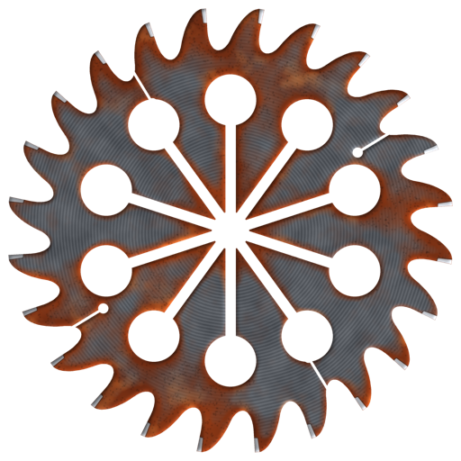

<a href="https://lab.strangequery.com/heartburn/"><code>lab.strangequery.com/heartburn</code></a>

 

# heartburn

The world's fastest emulator for CARDIAC, the 1968 Bell Labs cardboard computer.

<h3>Note</h3>
This code library is used by the products below. To write CARDIAC programs in Rust, install the compiler with the
command below:

 

`cargo install cargo-cardiac`

This library will be included as part of that install. With the `tools` feature, it also has the programs `burn`,
`carc` and `ekg` (`heartburn::tools`), which `cargo cardiac run`, `debug` and `asm` are built on. To get them as
programs of their own, without Rust, see the [README](https://github.com/StrangeQuery/heartburn#installation).

<table>
<tr>
<td align="center" valign="top" width="33%"> <a href="https://crates.io/crates/cardiac"><b><code>cardiac</code></b></a> <b>Strange Query's Rust for CARDIAC</b></td>
<td align="center" valign="top" width="33%"> <a href="https://github.com/StrangeQuery/heartburn"><b>burn, carc and ekg</b></a> Programs to run, assemble and debug CARDIAC programs</td>
<td align="center" valign="top" width="33%"> <a href="https://lab.strangequery.com/cardigan/"><b>Cardigan</b></a> A CARDIAC machine in your browser</td>
</tr>
</table>

MIT licensed.
