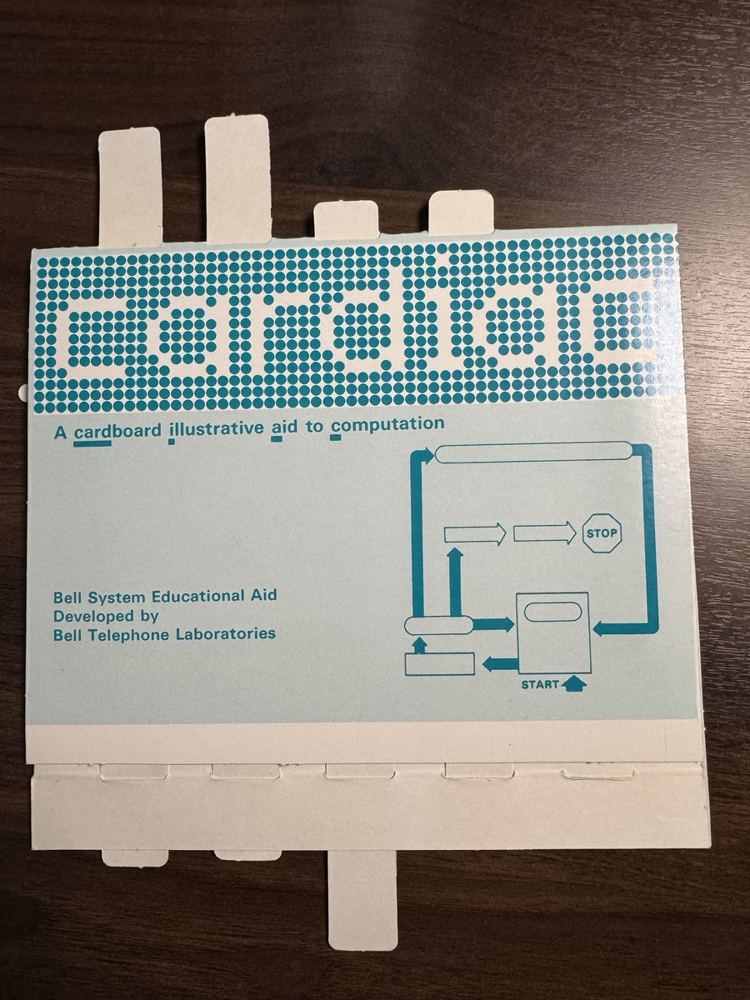

<p align="center"></p>

# cardiaq

Modern tools for CARDIAC, the 1968 Bell Labs cardboard computer: an assembler, a debugger, and a _stupid_ fast runtime.

```
carc countdown.cq     # compiles to countdown.cqb
burn countdown.cqb    # runs it in the fast emulator
```

## CARDIAC

[CARDIAC](https://en.wikipedia.org/wiki/CARDboard_Illustrative_Aid_to_Computation), the CARDboard Illustrative Aid
to Computation, was designed by David Hagelbarger and Saul Fingerman. It is the classic paper computer: you run it
by hand, sliding strips of cardboard to follow the program.

<p align="center"></p>

**cardiaq** is an SDK for writing, debugging and running CARDIAC programs on today's computers. Its engine,
HEARTBURN, runs CARDIAC at about a billion instructions per second on a single core of a Mac Studio (Apple M5
Ultra).

[What you can do](#what-you-can-do-with-this-sdk) • [Cardigan](#want-an-ide) • [What's in it](#whats-in-this-repo) •
[Install](#install) • [Walkthrough](#sample-walkthrough) • [CARDIAC in one page](#cardiac-in-one-page) • [carc](#carc) •
[burn](#burn) • [ekg](#ekg) • [Audio](#audio) • [How fast](#how-fast) • [As a library](#as-a-library)

## What you can do with this SDK

- **Write CARDIAC programs** as listings in the six-column format from the 1968 manual, which
  [Brian Stuart's CARDIAC page](https://www.cs.drexel.edu/~bls96/museum/cardiac.html) made popular.

- **Assemble them** into decks: the cards a CARDIAC loads. Any CARDIAC simulator can run them.

- **Run them** from the command line or in a pipeline, with input from the command line or from standard input.

- **Debug them** with breakpoints on labels, single-stepping, and watches that catch a program rewriting its own
  code.

- **Profile them** to see where the instructions went, which loop is hottest, and which code never ran.

- **Build on them.** Everything you need is open source and in this repository.


## Want an IDE?

[Cardigan](https://lab.strangequery.com/cardigan/) is a full IDE that runs in your browser. It builds on cardiaq, so
you can write, run and debug CARDIAC programs without installing anything. It uses a WebAssembly build of the
cardiaq SDK.

## What's in this repo

| | | resembles |
|---|---|---|
| [`carc`](#carc) | the assembler: turns six-column source code (`NAME.cq`) into decks (`NAME.cqb`) | `gcc` |
| [`burn`](#burn) | the runtime: runs decks in a fast interpreter | `java`, `dotnet` |
| [`ekg`](#ekg) | the debugger and profiler | `gdb`, `perf` |
| [`xtrack`](#xtrack) | encodes a channel of audio into a track for a CARDIAC to decode | `lame`, `flac` |
| [`lub`](#lub) | decodes a track on a CARDIAC and outputs the audio samples | `flac -d`, `mpg123` |
| [`dub`](#dub) | decodes two tracks, left and right, each on its own CARDIAC, and outputs stereo | `flac -d`, `mpg123` |

All of the commands follow the GNU conventions. They have `--help` and `--version`, short and long options, and
`--` to mark the end of the options. A file named `-` means standard input. Errors look like `PROG: message`, or
`FILE:LINE:COLUMN: error: message` when they point at a line. The exit status is 0 for success, 1 for failure and
2 for a mistake on the command line.

## Install

Currently no binaries are shipped. If you have [Rust](https://rustup.rs) installed, you can build them from the
source code:

    git clone https://github.com/StrangeQuery/cardiaq
    cd cardiaq
    cargo build --release

The commands end up in `target/release/`. Put that folder on your PATH.

## Sample Walkthrough

cardiaq uses the six-column assembly language format described on
[Brian Stuart's page](https://www.cs.drexel.edu/~bls96/museum/cardiac.html):

* **Address**: the cell, from 00 to 99. Cell 00 always holds 001, the loader uses cells 01 and 02 while it reads
  the deck in, and every JMP writes to cell 99.
* **Contents**: a number from -999 to 999. You can leave it out, and the assembler will work it out from the
  opcode and the operand.
* **Label**: an optional name for the cell, used mostly for jumps and data.
* **Opcode**: the name of the instruction. Strictly speaking it is redundant, because the first digit of the
  contents says the same thing.
* **Operand**: a cell, a label, or `label+N`.
* **Comment**: anything on the rest of the line.

Here is a program in this format that counts down from 5. Save it as `countdown.cq`:

    ; Countdown: prints 5, 4, 3, 2, 1, 0 and stops.
    ; Start at 10.
    ; Address Contents Label Opcode Operand Comment
    10   530  start  OUT  n      print n, take one off, and stop once it goes below zero
    11   130         CLA  n
    12   700         SUB  00     00 holds 001: whenever you need a 1, it is there
    13   316         TAC  done
    14   630         STO  n
    15   810         JMP  start
    16   900  done   HRS  00
    30   005  n      DATA 5      counts down from here

(The file names don't really matter. `.cq` and `.cqb` are just the conventions this SDK uses, and both are plain
text that any tool can create or change.)

**Assemble it.** `carc` writes `countdown.cqb` next to the listing:

    $ carc countdown.cq
    $ cat countdown.cqb
    # countdown.cqb: countdown.cq on cards, for the loader; it starts at 10
    # CARDIAC cards, one per line, read from the top. The program's input goes after them.
    002
    800
    010
    530
    ...
    030
    005
    002
    810

The first two cards, `002` and `800`, start the bootstrap loader. After them come pairs of cards, an address and
its contents, which fill in the cells. The deck ends with a jump to the start of the program, which is cell 10 here.
`carc` writes all of this for you.

**Run it.**

    $ burn countdown.cqb
    5
    4
    3
    2
    1
    0
         halted after 65 instructions

`burn` reads the program's input from standard input and prints its output on standard output. The message about
how the program stopped goes to standard error, so the output can be piped somewhere else cleanly. The count
includes the 30 instructions the loader ran to read the deck in. `ekg`, described below, loads a listing through the
same loader, so a program runs in `ekg` exactly as it does in `burn`.

**Make a mistake.** Misspell the label in cell 13, and get cell 11's contents wrong:

    $ carc oops.cq
    oops.cq:5:6: warning: contents +131, but CLA n is +130: loading the contents
    oops.cq:7:23: error: unknown label dun
    carc: oops.cq: not assembled: no deck written

**Debug it.** Stop at `start`, look at `n`, watch it change, then carry on. You can type the commands at the
`(ekg)` prompt, or give them on the command line with `-x`:

    $ ekg --batch countdown.cq -x 'break start' -x run -x 'p n' -x 'watch n' -x continue \
          -x continue -x 'info registers' -x delete -x continue
    breakpoint at 10 (start)
    breakpoint, cell 10
    10   530  start    OUT  n        ; print n, take one off, and stop once it goes below zero
    30 (n) = 005
    watching 30 (n)
    out: 5
    watch, cell 30 (n): 005 -> 004, written by cell 14
    15   810           JMP  start
    breakpoint, cell 10
    10   530  start    OUT  n        ; print n, take one off, and stop once it goes below zero
    pc 10  acc +0004  steps 36  reader []
    out: 4
    out: 3
    out: 2
    out: 1
    out: 0
    halted: HRS in cell 16, after 65 instructions

**Profile it.**

    $ ekg --profile countdown.cq 2>/dev/null
    countdown.cq: halted after 35 instructions (and 30 loading the deck), in 0.000 s (1.3 million a second)

    Hottest cells:
               6  17.14%  10   530  start    OUT  n        ; print n, take one off, and stop once it goes below zero
               6  17.14%  11   130           CLA  n
               6  17.14%  12   700           SUB  00       ; 00 holds 001: whenever you need a 1, it is there
               6  17.14%  13   316           TAC  done
               5  14.29%  14   630           STO  n
               5  14.29%  15   810           JMP  start
               1   2.86%  16   900  done     HRS  00
    ...
    Cells written by the program:
      30  n        written          5
      99           written          5  the way back JMP leaves

    Listed instructions never run:
      none

You can also do all of this in a browser with [Cardigan](https://lab.strangequery.com/cardigan/). It uses the same
assembler and the same machine, and it draws the machine as it runs.

## CARDIAC in one page

Memory is 100 cells, numbered 00 to 99. Each cell holds a sign and three digits, so a number from -999 to 999. The
accumulator holds a sign and four digits. Cell 00 is wired to 001 and can't be changed. That 001 is the loader's
first instruction, and it also gives every program a 1 whenever it needs one. An instruction is three digits: the
opcode, followed by a two-digit address.

| | opcode | |
|---|---|---|
| 0 | `INP a` | read the next input card into cell a |
| 1 | `CLA a` | clear the accumulator and add cell a, which loads it |
| 2 | `ADD a` | add cell a to the accumulator |
| 3 | `TAC a` | test the accumulator, and jump to a if it is negative |
| 4 | `SFT lr` | shift the accumulator l digits to the left, then r digits to the right |
| 5 | `OUT a` | output the value in cell a |
| 6 | `STO a` | store the last three digits of the accumulator in cell a |
| 7 | `SUB a` | subtract cell a from the accumulator |
| 8 | `JMP a` | jump to a; first it writes 8 and the address after the JMP into cell 99, so a subroutine can jump back |
| 9 | `HRS a` | halt, leaving the program counter on a |

There is no index register. To step through an array, a program rewrites the address inside one of its own
instructions. That is exactly what `ekg`'s `watch` command is for.

## carc

`carc` is the assembler. It turns a listing into a deck.

    carc countdown.cq                           # writes countdown.cqb next to it
    carc --start-at=10 -o out.cqb countdown.cq  # options can go before or after the file
    carc - < countdown.cq | burn -              # read the listing from standard input, write the deck to standard output

**Listings.** A listing has one cell per line. The columns are either Brian Stuart's six, `ADDRESS CONTENTS LABEL
OPCODE OPERAND COMMENT`, or the manual's three, `ADDRESS CONTENTS COMMENT`. You can leave the contents out, and
`carc` works them out from the opcode and the operand. The operand can be a number, a `label`, or `label+N`.
`DATA` (or `DAT`) puts a plain number in a cell. Lines that aren't cells, such as titles, prose, and comments
starting with `;` or `#`, are skipped.

**Where the program starts.** The deck starts the program at the cell given by `--start-at`. Without it, `carc`
looks in the listing: first for a `Start at NN.` line, then for a line labelled `start`, and otherwise it uses the
first instruction.

**Errors and warnings** are reported the way a compiler reports them. While there are errors, no deck is written.
If a cell's contents disagree with its opcode and operand, that is only a warning, and the contents are what get
loaded.

| | |
|---|---|
| `-o`, `--output=FILE` | write the deck to FILE (`-` means standard output). By default it goes to `NAME.cqb` next to `NAME.cq`, or to standard output if the listing came from standard input. |
| `--start-at=NN` | start the program at cell NN |
| `-h`, `--help` | display help and exit |
| `--version` | output version information and exit |

The exit status is 0 if the deck was written. It is 1 if the listing has errors or a file can't be read or
written, and 2 if there is a mistake on the command line.

## burn

`burn` is the runtime, and the fastest CARDIAC emulator around today.

    burn countdown.cqb           # run a deck
    burn add.cqb -- 123 456      # give input cards after the deck (the -- is optional)
    echo 123 456 | burn add.cqb  # or on standard input, where each card is read when an INP asks for it
    carc - < add.cq | burn -     # read the deck itself from standard input
    burn bench                   # measure how fast this machine runs CARDIAC

**Decks.** A deck is plain text with one card per line. Lines starting with `#` are comments. `burn` has no
automatic loader, so a deck has to load itself, the way
[Brian Stuart's page](https://www.cs.drexel.edu/~bls96/museum/cardiac.html) describes. `carc` writes decks that do.

**Output.** Every value the program outputs is printed as a number on its own line. How the program stopped, and
after how many instructions, goes to standard error. If a program's output values are characters (65 for A, 10
for a new line), pipe the output through perl:

    burn hello.cqb | perl -CO -ne 'print chr if $_ >= 0'

**Programs in several decks.** A program too big for memory comes as `NAME.cqb`, `NAME.2.cqb`, and so on. When a
deck is done, it halts with the program counter on the number of the deck to load next (HRS n), or on 00 when the
whole program is finished. `burn` then does what a person running the machine would do: it puts that deck in the
reader and starts the loader at 00. The decks can be loaded in any order, as often as the program asks.

| | |
|---|---|
| `--limit=N` | stop a program after N instructions (the default is a billion) |
| `-h`, `--help` | display help and exit |
| `--version` | output version information and exit |

Options go before the deck. Everything after the deck is input, including anything that starts with a minus sign.
The exit status is 0 if the program halted or ran out of input cards. It is 1 if the deck can't be read, or if the
program never stops (a run stops after a billion instructions, or after `--limit`). It is 2 if there is a mistake
on the command line.

## ekg

`ekg` is the debugger and the profiler. You give it either a listing or a deck, followed by the program's input.
`ekg` tells which one it has from what is inside the file. A listing is assembled the way `carc` assembles it, and
its labels and comments are kept for display. A deck is loaded through its own loader, the way `burn` loads it, and
then disassembled.

    ekg countdown.cq             # debug at the (ekg) prompt
    ekg --batch mul.cq -x 'break 17' -x run -x 'p p' -- 6 7
    ekg --profile mul.cq -- 6 7  # run to the end and report where the instructions went

**Debugging.** The commands are the same as gdb's wherever gdb has an equivalent. A PLACE is a cell (00 to 99), a
label, or `label+N`.

| | |
|---|---|
| `run`, `r` | start the program again from the beginning, with its input, and continue |
| `continue`, `c` | run until a breakpoint, a watch, a halt, or an INP with no card to read |
| `step`, `s` [N] | run one instruction, or N of them |
| `next`, `n` [N] | like `step`, but when a JMP calls a routine, run the whole routine and stop at the cell after the JMP. (A JMP counts as a call when the code it jumps to reads cell 99, the way back, before it reaches another JMP.) |
| `break`, `b` PLACE | stop before the instruction in PLACE runs |
| `watch` PLACE | stop after an instruction writes to PLACE |
| `delete`, `d` [PLACE] | remove the breakpoint and the watch on PLACE, or all of them if no PLACE is given |
| `info break`, `i b` | list the breakpoints and watches |
| `info registers`, `i r` | show the program counter, the accumulator, how many instructions have run, and the cards in the reader |
| `print`, `p` PLACE | show a cell's value, and what it means as an instruction (`p acc` and `p pc` also work) |
| `x` PLACE [N] | show the values of N cells starting at PLACE (10 if N isn't given) |
| `list`, `l` [PLACE] | show the listing around the program counter (or around PLACE), with the program counter marked `>` and breakpoints marked `b` |
| `set` PLACE VALUE | write a value into a cell (`set acc VALUE` and `set pc PLACE` also work) |
| `input` CARDS... | add cards to the reader, after the ones already in it |
| `help`, `h` | list the commands |
| `quit`, `q` | leave |

Pressing Enter on an empty line repeats the last `step`, `next` or `continue`. Whenever `ekg` stops, it shows the
next instruction the way the listing has it. If the program has rewritten that cell, the instruction is decoded
again from the new value. Each value the program outputs is printed as soon as it is output, on a line starting
with `out:`. If an INP finds no card left, `ekg` stops and waits for you to give it more with `input`.

**Profiling.** `--profile` runs the program to the end and prints a report on standard output, while the program's
own output goes to standard error. The report shows how many instructions ran, the hottest cells, every cell of the
listing with how often it ran, the cells the program wrote to (and which of those it also ran, meaning code it
rewrites), and the listed instructions that never ran. If you give no input, the program reads its cards from
standard input, as it would in `burn`. To see every instruction, `ekg` drives the machine one instruction at a time.
It profiles about 270 million instructions per second, a quarter of `burn`'s speed, and `burn` doesn't pay anything
for it.

| | |
|---|---|
| `-x`, `--eval-command=COMMAND` | carry out COMMAND (you can give any number of them, and they run in order) |
| `--batch` | carry out the `-x` commands, then exit without reading standard input |
| `-q`, `--quiet`, `--silent` | skip the introduction |
| `--profile` | profile instead of debugging |
| `--limit=N` | stop a run after N instructions (the default is 1,000,000,000) |
| `--start-at=NN` | start a listing at cell NN (by default, where `carc` would start it) |
| `--help` | display help and exit |
| `--version` | output version information and exit |

The exit status is 0 on success. It is 1 if something failed: the listing has errors, a `-x` command failed in
`--batch` mode, or a profile run was stopped by the limit. It is 2 if there is a mistake on the command line.

## Audio

`xtrack`, `lub` and `dub` play sound that a CARDIAC decodes. The CARDIAC does all of the decoding arithmetic for
every sample: every prediction, every correction and every carry. The host only feeds it cards and passes its
output on to the speakers. It works in three steps:

1. `xtrack` encodes one channel of audio into a track, which is a file of CARDIAC cards. You do this once, ahead of
   time.
2. `lub` plays one channel and `dub` plays two (stereo). For each channel, they run the decoder,
   [`audio/decode.cq`](audio/decode.cq), on a CARDIAC, and they give it the track's cards one at a time, whenever
   one of its INP instructions asks for a card.
3. The decoder outputs each sample as two values: first the thousands, then the units. It has to, because a single
   value from -999 to 999 doesn't have enough levels for good sound. `lub` and `dub` join each pair back into a
   16-bit sample and write it out as soon as it is decoded.

Here is how to get from a wav file to your speakers, using `ffmpeg` to read the audio and `ffplay` to play it:

    ffmpeg -i song.wav -af 'pan=mono|c0=c0' -ar 48000 -f s16le - | xtrack > song.left.track
    ffmpeg -i song.wav -af 'pan=mono|c0=c1' -ar 48000 -f s16le - | xtrack > song.right.track

    lub song.left.track | ffplay -nodisp -autoexit -f s16le -ar 48000 -ch_layout mono -
    dub song.left.track song.right.track | ffplay -nodisp -autoexit -f s16le -ar 48000 -ch_layout stereo -

The first two commands make the tracks for the left and right channels. The last two play them, in mono and in
stereo. The samples come out raw, as signed 16-bit little-endian numbers with no header, so you have to tell the
player what they are: `-f s16le` for the format, `-ar 48000` for the sample rate the audio was encoded at, and mono
or stereo. To save the result as a wav file instead of playing it:

    dub song.left.track song.right.track | ffmpeg -f s16le -ar 48000 -ac 2 -i - song.cardiac.wav

The encoding is a form of ADPCM designed around CARDIAC's decimal arithmetic. The audio is split into blocks of 64
samples, and each block has a step size of M x 10^K. For each sample, the decoder predicts the next value from a
straight line through the previous two samples, and the track's card for that sample says how far to correct the
prediction, as a three-digit code times the step size. Decoding takes about 40 instructions per sample, which is
about 2 million instructions per second for one channel at 48 kHz. [docs/AUDIO.md](docs/AUDIO.md) explains how we
built it and why it has to work this way. To watch the decoder at work, [audio/](audio/) has a 133-card excerpt of
The Blue Danube that is short enough to step through in `ekg` or Cardigan.

## xtrack

`xtrack` encodes one channel of audio into a track for the decoder.

**Input.** `xtrack` reads raw audio: nothing but the samples for one channel, one after another, each a signed
16-bit little-endian number. There is no header, so nothing in the file says what the sample rate is. We give such
files the extension `.s16` (signed, 16 bits), but that's only a naming convention. You can make one from almost
any audio file with `ffmpeg`. This takes the left channel of `song.wav` at 48 kHz:

    ffmpeg -i song.wav -af 'pan=mono|c0=c0' -ar 48000 -f s16le song.left.s16

Use `c0=c1` instead of `c0=c0` to take the right channel. Any sample rate works, but because the rate isn't recorded
anywhere, you have to give it to the player later.

Then encode the samples, either from the file or straight from `ffmpeg` through a pipe:

    xtrack song.left.s16 > song.left.track
    ffmpeg -i song.wav -af 'pan=mono|c0=c0' -ar 48000 -f s16le - | xtrack > song.left.track

**Output.** The track goes to standard output, one card per line. Each block of 64 samples starts with two cards,
K and M, which give the block's step size. Then come 64 cards, one per sample, each a code from -500 to 499. The
last card is -1, which marks the end. For each block, `xtrack` tries every step size and keeps the one with the
smallest error. It chooses each code to match the sample the decoder will actually produce, so small errors don't
add up over time. It encodes 32 seconds of audio in about half a second.

| | |
|---|---|
| `-h`, `--help` | display help and exit |
| `--version` | output version information and exit |

The exit status is 0 if the track was written. It is 1 if the samples can't be read, if there is an odd number of
bytes, or if the track can't be written. It is 2 if there is a mistake on the command line.

## lub

`lub` plays one channel. A single CARDIAC runs the decoder on the track, and `lub` writes each sample to standard
output as soon as the CARDIAC has decoded it.

    lub song.left.track | ffplay -nodisp -autoexit -f s16le -ar 48000 -ch_layout mono -
    xtrack < song.left.s16 | lub | ffplay ...    # the track can also come from standard input

**Output.** Raw samples, as signed 16-bit little-endian numbers, in mono. `lub` won't write them to a terminal, so
pipe them to a player or into a file. If the player stops reading, `lub` stops too, without an error.

**Errors.** When something is wrong, `lub` stops with a message instead of playing noise. That happens if the track
ends without its end card, if a line isn't a card (the message gives the line number), or if the decoder's two
values for a sample don't make a 16-bit number.

| | |
|---|---|
| `-h`, `--help` | display help and exit |
| `--version` | output version information and exit |

The exit status is 0 if the track was played to the end, or if the player stopped reading. It is 1 if the track
can't be read or the decoder can't decode it. It is 2 if there is a mistake on the command line.

## dub

`dub` plays stereo. It takes two tracks, one for the left channel and one for the right, and each one is decoded by
its own CARDIAC.

    dub song.left.track song.right.track | ffplay -nodisp -autoexit -f s16le -ar 48000 -ch_layout stereo -
    xtrack < song.left.s16 | dub - song.right.track | ffplay ...    # one of the tracks can come from standard input

**How it works.** The two CARDIACs take turns on a single thread, one block at a time. First the left CARDIAC is
given the next 66 cards of its track (one header and 64 codes), and it runs until it asks for more cards. Then the
right CARDIAC does the same. `dub` joins each channel's pairs of values into samples, and writes them in the order
left, right, left, right, which is what a stereo stream is.

**Output.** Raw samples, as signed 16-bit little-endian numbers, in stereo, with the left sample first. As with
`lub`, it won't write to a terminal, and if the player stops reading, `dub` stops too.

**Errors.** `dub` reports the same errors as `lub`, and says which track each one is in. It also reports one more:
if the two tracks are different lengths, it says which one is longer and by how many samples, instead of playing one
channel on its own.

| | |
|---|---|
| `-h`, `--help` | display help and exit |
| `--version` | output version information and exit |

The exit status is 0 if both tracks were played to the end, or if the player stopped reading. It is 1 if a track
can't be read, if the decoder can't decode it, or if the two tracks are different lengths. It is 2 if there is a
mistake on the command line.

## How fast

`burn bench` runs three countdown loops nested inside each other, 626.5 million instructions in all, on one core.
Here is the same program on every CARDIAC emulator we could build and run on an Apple M5 Ultra (October 2026):

| emulator                          | language   | million instructions a second | per instruction |
|-----------------------------------|------------|-------------------------------|-----------------|
| **HEARTBURN**                     | Rust       | **1,070**                     | **0.94 ns**     |
| InPermutation/CARDIAC `cem.c`     | C (`-O2`)  | 438                           | 2.3 ns          |
| fzaca/CardiacVisualizer           | Rust       | 110                           | 9.1 ns          |
| weibell/python-cardiac-emu        | Python 3.9 | 2.4                           | 417 ns          |
| rzinkstok/cardiac                 | Python 3.9 | 1.25                          | 800 ns          |

These figures are per core. A CARDIAC program runs one instruction after another, so a single run uses a single
core, but separate runs can go side by side on as many cores as the machine has.

How it gets this fast, so far:

- Each cell's instruction is decoded once and kept next to its value. It is decoded again only when the cell is
  written, which matters because CARDIAC programs rewrite their own code all the time to index arrays. The decoding
  comes from a 4 KB table that holds the decoding of every possible word.
- The accumulator wraps around with a comparison rather than a division.
- JMP writes cell 99 already decoded.
- A 101st decoded cell sends the program counter back round to 00, so no step has to check for it.
- Tracing, which `burn` uses to say where a run stopped, is switched on or off when the program is compiled, so it
  costs nothing when it is off.
- The main loop never allocates memory.

What comes next is fewer processor cycles per step, and running the idioms CARDIAC code is made of as single
operations. For example, an indexed load is four instructions of self-modifying code. There is no JIT compiler.
HEARTBURN is an interpreter, made as fast as an interpreter can be.

## As a library

All of the commands are built on one Rust crate, which is called `heartburn` for now. Until the runtime and the
tools are packaged separately, it holds both the engine and the SDK's code: the machine (`cardiac`), the assembler
that `carc` and Cardigan use (`assemble`), decks (`tape`), and listings in the manual's other formats (`listing`).

```rust
use heartburn::listing::{self, Listing};
use heartburn::tape::Tape;

// the manual's Program No. 1: read two cards, output their sum
let read = listing::parse("17 034\n18 035\n19 134\n20 235\n21 636\n22 536\n23 900\n")?;
let Listing::Memory(cells) = read.listing else { return Err("a deck, not a memory listing".into()) };
let tape = Tape::one(listing::deck(17, &cells)?);
let (outputs, why, steps) = tape.run(&[2, 3], 1_000)?;   // [5], Halt, 34 instructions
```

`examples/add.rs` is this same code, ready to run with `cargo run --example add`. `cardiac::run` runs a deck
directly, and `cardiac::Machine` is the machine a debugger holds onto: you can step it, run it to a breakpoint, and
read and write its memory. Breakpoints cost nothing per instruction, and a plain run doesn't pay for any of it.

## License

MIT.
