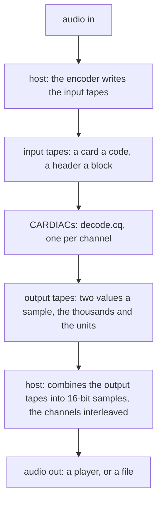
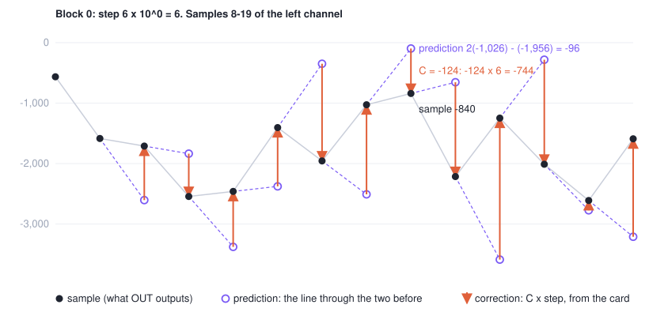
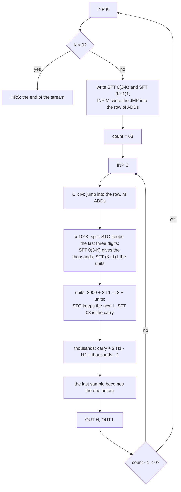
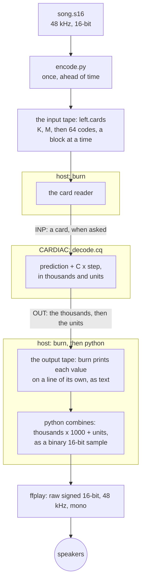
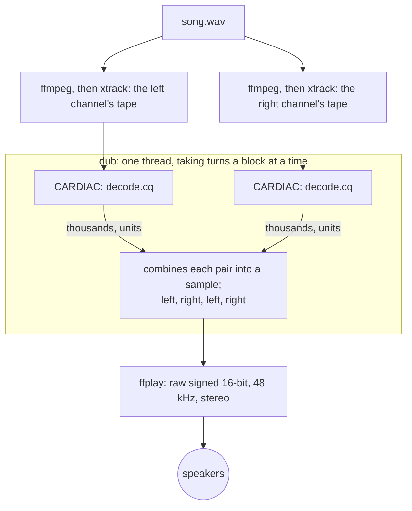

# Playing audio with CARDIAC math

The goal: play CD-quality sound (48 kHz, 16-bit) where every sample is worked out by a CARDIAC. The host may deal
cards to the machine and send the numbers it outputs to the speakers; it may not do the arithmetic. The test
material is a 4:45 stereo soundtrack: music, voices, and quiet room noise under the voices, which is the hardest
part to code well.

Part 1 builds a mono player: a codec CARDIAC can decode, the decoder as a CARDIAC listing, an encoder, the
commands that play a channel as it is decoded, and then `lub`, the mono player as a program. Part 2 makes it
stereo, ending with `dub`.

In this repository: the decoder is [`audio/decode.cq`](../audio/decode.cq); the coding is `heartburn::audio`
([`src/audio.rs`](../src/audio.rs)); `xtrack` codes a channel, `lub` plays one and `dub` plays two
([`src/bin/`](../src/bin/)). [`encode.py`](encode.py), beside this page, is the encoder as it was first written,
the reference the Rust one was checked against.

## Part 1: a mono player

### What CARDIAC gives us

- 100 cells of three digits and a sign (-999..999). Cell 00 holds 001, the loader uses 01 and 02, and every JMP
  writes cell 99, so a program has cells 03 to 98: 96 cells.
- An accumulator of four digits and a sign (-9999..9999).
- ADD, SUB, CLA and STO; TAC (jump if negative); JMP; INP and OUT; HRS. No multiply and no divide.
- SFT, which shifts the accumulator's magnitude left, then right, by whole decimal digits, keeping the sign.
- STO keeps the last three digits of the accumulator, with its sign: 2,040 stores as 40, and -2,040 as -40.

### The shape of it: tapes in, tapes out

Everything here follows one path:

1. **Audio goes in.** The host reads the audio file.
2. **The host writes the input tapes**: the encoder turns each channel into a stream of cards, ahead of time.
3. **The CARDIACs write the output tapes**: each decodes its input tape, one card at a time, and outputs values.
4. **The host combines the output tapes** into an audio stream and writes it out to a player or a file.

It pretty much has to be this way, because a CARDIAC value isn't enough levels for good sound. A value from
-999 to 999 is 1,999 levels, about 11 bits. CD audio has 65,536 (16 bits). One value a sample would leave quiet
passages, a voice over room noise say, only a handful of levels, with hiss under all of them. So every sample
leaves the CARDIAC as more than one value, and something has to put them back together into the sound card's
format. That is the host's last step: a change of format, like printing a number in decimal, not part of the
decoding. Every prediction, every correction and every carry happens on the CARDIAC.



### Why not MP3 or AAC

The compressed formats the soundtrack came in are built on transforms full of multiplication. CARDIAC would
have to grind through every multiply in loops of ADDs, which is a couple of cores' worth of work, and a big
program to write. Small files aren't the goal anyway. The goal is a decoder simple enough to be exact on CARDIAC.

### ADPCM: predict, then correct

ADPCM (adaptive differential pulse-code modulation) predicts each sample from the ones before it and sends only
the correction, as a small code times a step size. Decoding is a prediction and an add. The hard part, choosing
each code, is the encoder's, and the encoder runs once, ahead of time, on any computer. That split suits CARDIAC.

### How many digits a sample

A card holds three digits. We tried two ends:

- **1 digit a sample**, three samples a card: ten levels, about 3.3 bits, like the 4-bit ADPCM of 90s games.
- **3 digits a sample**, one sample a card: a code from -500 to 499.

Files aren't the goal, so the deck's size didn't decide it. On the 16-second test clip (107-123 s, a voice over
room noise), 1 digit came out at 31 dB signal-to-noise, with audible hiss under the voice. 3 digits came out at
69.7 dB and couldn't be told from the source by ear. We use 3.

### Adapting the step

The first version adapted the step size as it went, from the codes themselves, the way IMA ADPCM does: a big code
made the step grow, a small one made it shrink. It did badly on this soundtrack, which is mixed loud and limited:

| Clip | 1 digit | 3 digits |
|---|---|---|
| 16 s from 107 s, step adapted from the codes | 23.6 dB | 29.0 dB |

At 3 digits, 50,593 of the clip's 768,000 codes hit the ends of their range: the step couldn't grow fast enough to
follow the music (slope overload). Faster-rising rules helped 3 digits (up to 49.1 dB on 8 seconds) and hurt
1 digit (down to 19.0 dB).

The fix is the one the PlayStation's and the SNES's sound chips use. The encoder chooses the step for each short
block and sends it as a header. On CARDIAC that's just a few more cards. On 4 seconds from 107 s:

| Block | 1 digit | 3 digits |
|---|---|---|
| 16 samples | 32.4 dB | |
| 28 samples | 31.9 dB | |
| 32 samples | | 71.1 dB |
| 64 samples | | 70.3 dB |

We use blocks of 64 samples: two header cards per 64 code cards.

### Steps CARDIAC can multiply by

Every sample needs C times the step, and CARDIAC can't multiply. So the step is M x 10^K, with M from 1 to 9
and K from 0 to 3:

- **x M** is a row of nine `ADD c` instructions. The decoder jumps into the row at the point that leaves M of them.
- **x 10^K** is a shift of K digits, which is one SFT.

K stops at 3 because the shift that finds the thousands is `SFT 0(3-K)`. A first try used M of 1, 2 or 5 only;
any M from 1 to 9 costs nothing more, since the row is there anyway, and gives the encoder finer steps.

C x M reaches 499 x 9 = 4,491, which still fits the accumulator.

### The prediction, and the 106-cell problem

Each block could choose between two predictions:

- **the last sample**, or
- **the line through the last two**: twice the last, less the one before. That's only adds.

The decoder that let each block choose came to about 106 cells, against 96 free. The choice would be a header
card that rewrites four more instructions (an ADD or SUB of the history, or of a zero), and the code to build them
from it. So we measured what the choice was worth, one second at each of eight points in the soundtrack:

| Clip (s) | Either, per block | Line only | Last sample only |
|---|---|---|---|
| 20 | 60.2 | 59.6 | 60.1 |
| 60 | 70.9 | 68.5 | 68.6 |
| 110 | 70.1 | 68.3 | 69.4 |
| 140 | 76.8 | 75.7 | 75.3 |
| 160 | 111.4 | 111.4 | 96.9 |
| 200 | 89.9 | 89.9 | 84.4 |
| 230 | 105.9 | 105.9 | 105.9 |
| 270 | 70.0 | 64.8 | 69.0 |

(signal-to-noise in dB)

The line alone costs at most 5 dB and never falls below 59.6 dB. That compromise fits in memory, so the line is
the only prediction, and the header is two cards: K and M.

Here is the line at work on twelve real samples. Each hollow circle is where the line through the two samples
before it lands; each arrow is the correction, C times the block's step, that takes the prediction to the sample.
This block is noisy, so the corrections are large. On smooth music the circles sit nearly on the samples, and the
codes are small.



### A 16-bit sample in three-digit cells

A sample runs from -32,768 to 32,767, which fits neither a cell nor the accumulator. The decoder keeps each sample
in two cells: H, the thousands, and L, the units from 0 to 999, so the sample is H x 1000 + L. -12,345 is H = -13,
L = 655.

The correction C x M x 10^K is split the same way, into a thousands part and a units part, by two SFTs that keep
its sign. The new units are summed over a bias of 2000 so the sum can't go negative:

    sum = 2000 + 2 L1 - L2 + units      (2 to 4,997)
    L   = the sum's last three digits    (STO keeps them)
    H   = SFT 03 of the sum (the carry, 0 to 4) + 2 H1 - H2 + thousands - 2

The bias makes the carry come out of a plain shift, and the -2 takes the bias back out of the thousands.

### The header writes the program

Each block's header is two numbers, K and M, and the decoder turns them into three of its own instructions:

| Cell | Becomes | Built as |
|---|---|---|
| `mul` | JMP into the row of ADDs, M from its end | `JMP x1`, less M, plus 1 |
| `shi` | SFT 0(3-K), the thousands | 403 - K |
| `slo` | SFT (K+1)1, the units | 411 + 10 K |

So the stream stays plain numbers, not instructions that depend on where the decoder keeps things. A K below zero
ends the stream.

### What bit: a product too big for a cell

The first decoder stored C x M in a cell, then shifted the thousands and the units out of it. A cell holds three
digits and C x M can have four, so the thousands were lost. The first sample of the test came out 40 instead of
2,040. The comparison against the encoder's model caught it on sample 0, and `ekg` found it: the thousands went to
0 after `SFT 03`, because the cell it shifted held 040.

The fix costs nothing. The units depend only on the last three digits, which is exactly what STO keeps. So the
decoder stores C x M (keeping its last three digits), shifts the thousands out of the accumulator, which still
holds all four, then reloads the stored digits for the units.

### What the decoder does for each sample

| Cells | Instructions | What |
|---|---|---|
| 19-21 | 3 | INP the code C, clear the accumulator, jump into the row |
| 22-30 | M | C x M |
| 31-36 | 6 | x 10^K, split into thousands and units |
| 37-43 | 7 | the units: 2000 + 2 L1 - L2 + units; STO keeps the new L |
| 44-50 | 7 | the thousands: carry + 2 H1 - H2 + thousands - 2 |
| 51-58 | 8 | the last sample becomes the one before |
| 59-60 | 2 | OUT the thousands, OUT the units |
| 61-65 | 5 | count down the block; at its end, read the next header |

That's 38 + M instructions a sample, plus 16 for each block's header.



### The first three samples, cell by cell

The test clip's left channel starts with the cards `0 6 332 -458 143`: a header with K = 0 and M = 6 (a step of
6), then the first three codes. The decoder starts with all history cells at 0.

| | Sample 0 | Sample 1 | Sample 2 |
|---|---|---|---|
| The card C | 332 | -458 | 143 |
| C x M | 1,992 | -2,748 | 858 |
| Thousands (SFT 03) | 1 | -2 | 0 |
| Units (STO keeps the last three digits; SFT 11) | 992 | -748 | 858 |
| History before: H1, L1 and H2, L2 | 0, 0 and 0, 0 | 1, 992 and 0, 0 | 1, 236 and 1, 992 |
| Units sum: 2000 + 2 L1 - L2 + units | 2,992 | 3,236 | 2,338 |
| New L, and the carry | 992, carry 2 | 236, carry 3 | 338, carry 2 |
| New H: carry + 2 H1 - H2 + thousands - 2 | 2 + 0 - 0 + 1 - 2 = 1 | 3 + 2 - 0 - 2 - 2 = 1 | 2 + 2 - 1 + 0 - 2 = 1 |
| OUT | 1, then 992 | 1, then 236 | 1, then 338 |
| The sample | 1,992 | 1,236 | 1,338 |
| Check: prediction + C x step | 0 + 1,992 | 3,984 - 2,748 | 480 + 858 |

The prediction for sample 1 is 2 x 1,992 - 0 = 3,984, and for sample 2 it is 2 x 1,236 - 1,992 = 480. The decoder
never forms those five-digit numbers. It works in thousands and units throughout, and the carry joins them.

### The decoder

[`audio/decode.cq`](../audio/decode.cq), in cardiaq's six-column listing format. `carc audio/decode.cq` makes the
deck `audio/decode.cqb`; `lub` and `dub` carry the listing built in, and assemble it as `carc` does.

```
; Decimal ADPCM decoder: a stream of cards in, 16-bit samples out, each as two values: the thousands, then the
; units (0-999), so the sample is thousands * 1000 + units.
;
; The stream is blocks of 64 samples. A block starts with two cards, K (0-3) and M (1-9): its step is M * 10^K.
; Then a card a sample, C (-500 to 499): the sample is the prediction, the line through the last two (twice the
; last, less the one before), plus C * step. A K below zero ends the stream.
;
; A sample takes two cells: H, the thousands, and L, the units (0-999). The header writes three instructions into
; the program: the jump into a row of nine ADDs that leaves M of them, for C * M; and the two SFTs that split
; C * M * 10^K into thousands and units (SFT 0(3-K) and SFT (K+1)1, both keeping its sign). C * M can be four
; digits, which a cell can't hold: the thousands are shifted out of the accumulator, the units out of the last three
; digits, which STO keeps. The units are summed over 2000 so they stay positive: STO keeps the new units and
; SFT 03 is the carry.
;
; Address Contents Label Opcode Operand Comment
  03            block   INP   k        03-18: the header
  04                    CLA   k
  05                    TAC   done
  06                    SFT   10       SFT (K+1)1 for the units
  07                    ADD   s411
  08                    STO   slo
  09                    CLA   s403     SFT 0(3-K) for the thousands
  10                    SUB   k
  11                    STO   shi
  12                    INP   m
  13                    CLA   jx1      JMP into the row, M ADDs from its end
  14                    SUB   m
  15                    ADD   00
  16                    STO   mul
  17                    CLA   n
  18                    STO   cnt
  19            sample  INP   c        19-31: C * M
  20                    CLA   z
  21            mul     DATA  0        (JMP x1+1-M)
  22                    ADD   c
  23                    ADD   c
  24                    ADD   c
  25                    ADD   c
  26                    ADD   c
  27                    ADD   c
  28                    ADD   c
  29                    ADD   c
  30            x1      ADD   c
  31                    STO   u        31-36: * 10^K, split: the units come from C * M's last three digits
  32            shi     DATA  0        (SFT 0(3-K))
  33                    STO   hi
  34                    CLA   u
  35            slo     DATA  0        (SFT (K+1)1)
  36                    STO   lo
  37                    CLA   two      37-43: the units, 2000 + 2 L1 - L2 + lo
  38                    SFT   30
  39                    ADD   l1
  40                    ADD   l1
  41                    SUB   l2
  42                    ADD   lo
  43                    STO   ln
  44                    SFT   03       44-50: the thousands, carry + 2 H1 - H2 + hi - 2
  45                    ADD   h1
  46                    ADD   h1
  47                    SUB   h2
  48                    ADD   hi
  49                    SUB   two
  50                    STO   hn
  51                    CLA   l1       51-58: the last becomes the one before
  52                    STO   l2
  53                    CLA   ln
  54                    STO   l1
  55                    CLA   h1
  56                    STO   h2
  57                    CLA   hn
  58                    STO   h1
  59                    OUT   h1       59-60: the sample
  60                    OUT   l1
  61                    CLA   cnt      61-65: the next, or the next block's header
  62                    SUB   00
  63                    STO   cnt
  64                    TAC   block
  65                    JMP   sample
  66            done    HRS   00
  70            k       DATA  0
  71            m       DATA  0
  72            c       DATA  0
  73            u       DATA  0
  74            lo      DATA  0
  75            hi      DATA  0
  76            ln      DATA  0
  77            hn      DATA  0
  78            cnt     DATA  0
  79            n       DATA  63       a block is 64 samples
  80            two     DATA  2
  81            s411    DATA  411
  82            s403    DATA  403
  83            jx1     JMP   x1
  84            z       DATA  0
  85            l1      DATA  0
  86            l2      DATA  0
  87            h1      DATA  0
  88            h2      DATA  0
```

It uses 83 of the 96 free cells: code in 03-66, data in 70-88.

### The encoder

`encode.py` codes one channel. For each block it tries all 36 steps and keeps the one with the least squared
error. It codes closed loop: each code is chosen against the sample the decoder will actually produce, not the
original, so the encoder's errors never pile up. It never lets a sample leave 16 bits. With the cards, it can
write the samples the decoder should output, and those are what the decoder is checked against.

```python
#!/usr/bin/env python3
"""Encode one channel of raw 48 kHz stereo 16-bit audio as decode.cq's stream of cards.

    encode.py IN.s16 CHANNEL START_S SECONDS CARDS [EXPECT]

CHANNEL is 0 (left) or 1 (right). CARDS gets the stream, a card a line; EXPECT, if given, the samples the decoder
should output, a line each. Each block of 64 samples takes the step M * 10^K (M 1-9, K 0-3) with the least error,
coding closed loop against the decoder's own prediction (twice the last sample less the one before), and never
past 16 bits.
"""
import struct, sys

N = 64
STEPS = [(k, m) for k in range(4) for m in range(1, 10)]

def block(xs, s1, s2, step):
    err, out = 0, []
    for x in xs:
        e = 2 * s1 - s2
        lo, hi = -((32768 + e) // step), (32767 - e) // step
        c = max(-500, lo, min(499, hi, round((x - e) / step)))
        s = e + c * step
        err += (x - s) ** 2
        out.append((c, s))
        s2, s1 = s1, s
    return err, out

def encode(xs):
    cards, samples, s1, s2 = [], [], 0, 0
    for b in range(0, len(xs), N):
        blk = xs[b:b + N]
        blk += [blk[-1]] * (N - len(blk))
        best = min(((block(blk, s1, s2, m * 10**k), (k, m)) for k, m in STEPS), key=lambda r: r[0][0])
        (_, out), (k, m) = best
        cards += [k, m] + [c for c, _ in out]
        samples += [s for _, s in out]
        s1, s2 = out[-1][1], out[-2][1]
    return cards + [-1], samples

def main():
    src, ch, start, secs, dst = sys.argv[1], int(sys.argv[2]), float(sys.argv[3]), float(sys.argv[4]), sys.argv[5]
    with open(src, "rb") as f:
        f.seek(int(start * 48000) * 4)
        raw = f.read(int(secs * 48000) * 4)
    xs = list(struct.unpack(f"<{len(raw) // 2}h", raw)[ch::2])
    cards, samples = encode(xs)
    with open(dst, "w") as f:
        f.write("\n".join(map(str, cards)) + "\n")
    if len(sys.argv) > 6:
        with open(sys.argv[6], "w") as f:
            f.write("\n".join(map(str, samples)) + "\n")

main()
```

It is slow: about 30 seconds for 16 seconds of one channel, all of it in the search over steps. `xtrack` is the
same encoder in Rust (`heartburn::audio::encode`). It writes the same tape, card for card, in a quarter of a
second, and rounds halves to the even number as Python's `round` does, so the two agree. It adds one guard: when
the prediction overshoots far enough that a small step can't bring the sample back within 16 bits, that step is
not a choice for the block. (The Python would write a sample the decoder can't hold.) The largest step, 9,000,
always reaches.

### Running it

This is how the mono player was first put together: the Python encoder, `burn` and a few lines of Python. The input
is raw 48 kHz stereo 16-bit samples, which `ffmpeg` makes from any audio file. From the repository's top, with the
tools built:

```sh
B=target/release
ffmpeg -i song.wav -ar 48000 -ac 2 -f s16le song.s16
S=song.s16

# assemble the decoder (once): writes audio/decode.cqb
$B/carc audio/decode.cq

# encode the left channel, 16 seconds from 107 s: the cards, and the samples the decoder should produce
python3 docs/encode.py $S 0 107 16 left.cards left.expect

# decode it on a CARDIAC (--limit, since 16 seconds of a channel is about 32 M instructions)
$B/burn --limit=100000000000 audio/decode.cqb < left.cards > left.out
```

**Checking it.** `burn` prints each value the program outputs on a line of its own, so each sample is two lines,
the thousands then the units. Joining them and comparing with the model:

```sh
python3 -c '
import sys; f = sys.argv[1]
o = [int(x) for x in open(f + ".out")]
got = [o[i] * 1000 + o[i + 1] for i in range(0, len(o), 2)]
print(f, "matches" if got == [int(x) for x in open(f + ".expect")] else "DIFFERS")
' left
```

**Playing it as it's decoded.** `burn` reads each card when an INP asks for one and prints each value when OUT
outputs it, so a pipe plays the channel while the CARDIAC decodes it. A few lines of Python join each pair into a
16-bit sample, and `ffplay` sends the raw samples to the speakers:



The Python is the host's combining step, the last on the path. It reads the output tape two lines at a time, a
sample's thousands and its units, and writes the sample as two binary bytes, little-endian: 1,992 goes to `ffplay`
as `C8 07`. Raw samples carry no header, so `ffplay`'s flags say what they are: `-f s16le` (signed 16-bit,
little-endian), `-ar 48000` (the rate) and `-ch_layout mono` (one channel).

```sh
$B/burn --limit=100000000000 audio/decode.cqb < left.cards \
  | python3 -c '
import sys, struct
out = sys.stdout.buffer
for h in sys.stdin:
    out.write(struct.pack("<h", int(h) * 1000 + int(next(sys.stdin))))' \
  | ffplay -nodisp -autoexit -f s16le -ar 48000 -ch_layout mono -
```

This is the mono player. The CARDIAC decodes far faster than real time, so the sound card sets the pace: `burn`
blocks on a full pipe and waits for the speakers to catch up. The host deals cards and moves numbers; every sample
is worked out by the CARDIAC. We played the 16-second test clip this way, and it sounds the same as the source.

### lub: the mono player as a program

`lub` is that pipe's `burn` and Python in one program, about 130 lines with its help and error messages. It runs
one CARDIAC on the decoder, reads a card of the tape each time an INP asks for one, joins each pair of output
values into a sample, and writes the sample to standard output as soon as it is made. `xtrack` makes the tape:

```sh
ffmpeg -i song.wav -af 'pan=mono|c0=c0' -ar 48000 -f s16le - | $B/xtrack > song.left.tape
$B/lub song.left.tape | ffplay -nodisp -autoexit -f s16le -ar 48000 -ch_layout mono -
```

Its samples are the same bytes as the `burn` and Python pipe's. It stops with a message, not a noise, when a tape
has no end card, a line isn't a card, or the decoder's two values aren't a 16-bit sample; and quietly when the
player stops reading. The tests (`tests/audio.rs`, and `src/audio.rs`'s own) check that the CARDIAC's samples are
exactly the encoder's model, in the library and through the programs.

### Results

| | |
|---|---|
| Exact | the decoder's output equals the encoder's model on all 768,000 samples of each channel of the test clip, through files, through the pipe and through `lub` |
| Quality | 69.2 dB signal-to-noise over the 16-second stereo clip; by ear, no different from the source |
| Speed | 38 + M instructions a sample, 41.3 on average with the headers (31.7 M for 768,000 samples): about 2 M instructions a second per channel at 48 kHz |
| Memory | 83 of the 96 free cells |
| Encoding | `xtrack`: 0.25 s for 16 seconds of a channel, about 5 s for the whole soundtrack's; the Python, 30 s |
| Stream | 66 cards per 64 samples, plus one to end: 792,001 cards (3.0 MB as text) for 16 seconds of one channel |
| The whole soundtrack | about 28 M cards for both channels, 56 MB stored as 2 bytes a card, the same as the raw 16-bit audio |

The listening test turned up a 15.7 kHz whine in the 3-digit clip. It was in the source too, at the same level:
a recording of a fridge in the mix carries a CRT's line whine. The codec reproduced it faithfully; its own error
over the clip is about 1-2 units of a 16-bit sample.

## Part 2: making it stereo

Stereo is two channels, and the channels share nothing: each decoder keeps its own history and its own block
headers. So stereo is two CARDIACs running `decode.cq`, one per channel, each reading its own stream.

### Stereo the batch way

Running `burn` once per channel and writing the two outputs into a wav file is how the test clip was made:

```sh
python3 docs/encode.py $S 0 107 16 left.cards  left.expect
python3 docs/encode.py $S 1 107 16 right.cards right.expect
$B/burn --limit=100000000000 audio/decode.cqb < left.cards  > left.out
$B/burn --limit=100000000000 audio/decode.cqb < right.cards > right.out

python3 -c '
import struct, wave
ch = []
for f in ("left", "right"):
    o = [int(x) for x in open(f + ".out")]
    ch.append([o[i] * 1000 + o[i + 1] for i in range(0, len(o), 2)])
w = wave.open("cardiac.wav", "wb"); w.setnchannels(2); w.setsampwidth(2); w.setframerate(48000)
w.writeframes(b"".join(struct.pack("<hh", a, b) for a, b in zip(*ch))); w.close()
'
afplay cardiac.wav
```

That decodes everything first and plays it after. Streaming stereo needs the two outputs interleaved as they're
made, which a shell pipe doesn't do well.

### dub: two CARDIACs, one thread

Decoding costs about 4 M instructions a second for both channels, so a thread per channel would buy nothing and add
coordination. `dub` keeps one thread and two CARDIACs, and they take turns a block at a time. Each turn, a
channel's CARDIAC is given its tape's next 66 cards (a header and 64 codes) and runs until it asks for more, which is
exactly one block: 64 samples. Then the other channel's turn. Each machine stays a plain mono decoder with its own
100 cells and its own tape.

```sh
ffmpeg -i song.wav -af 'pan=mono|c0=c1' -ar 48000 -f s16le - | $B/xtrack > song.right.tape
$B/dub song.left.tape song.right.tape | ffplay -nodisp -autoexit -f s16le -ar 48000 -ch_layout stereo -
```

It is the same path as the mono player, with two of everything in the middle: two input tapes, two CARDIACs, two
output tapes. The host's combining step joins each channel's thousands and units as before, then interleaves the
channels, left then right, which is what a stereo stream is (and what `-ch_layout stereo` tells `ffplay` to expect).



Its output is, byte for byte, the stereo clip made the batch way above, in 0.26 s for the 16 seconds. Tapes of
different lengths are an error, said with which is longer and by how much, rather than one channel played on alone.

We considered and set aside:

- **One CARDIAC alternating the channels.** It doubles the history cells and makes one program interleave two
  decoders' bookkeeping, for the same cost. Harder to read, nothing gained.
- **Mid and side** (one machine codes left + right, the other left - right). When the channels are alike, the
  difference codes in fewer digits, but size isn't the goal, and undoing it would put arithmetic back on the host.

### Still to do

- A binary card format for long tapes (2 bytes a card), so the whole soundtrack isn't 130 MB of text.
- Playing in step with a picture: the samples handed to the sound card on a clock, rather than as fast as the
  pipe takes them.
